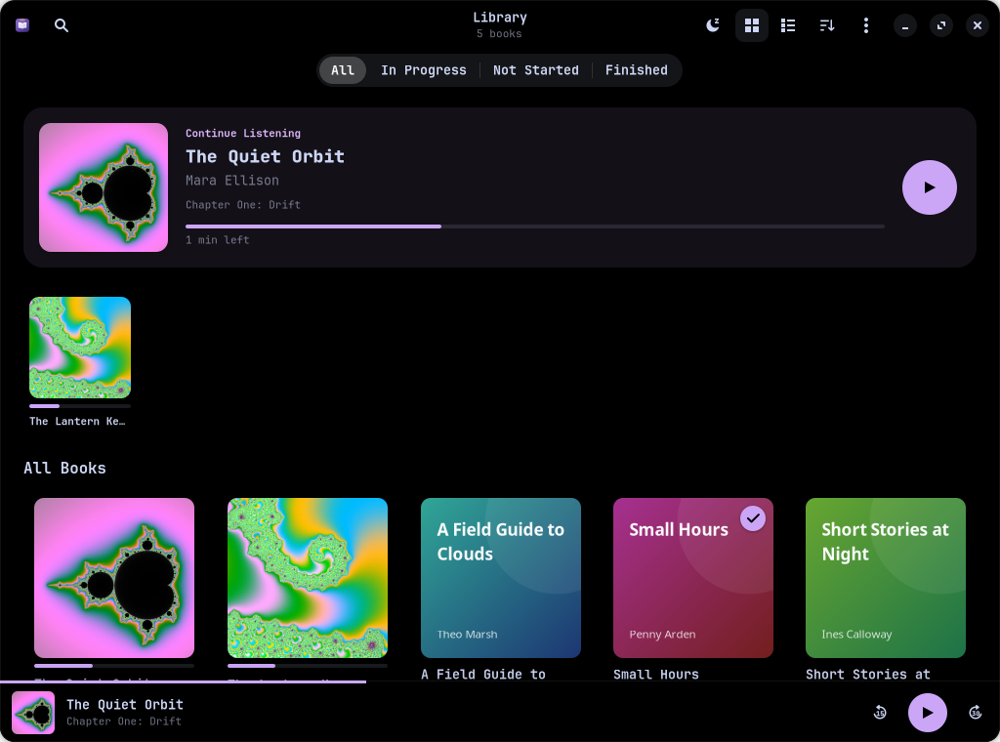
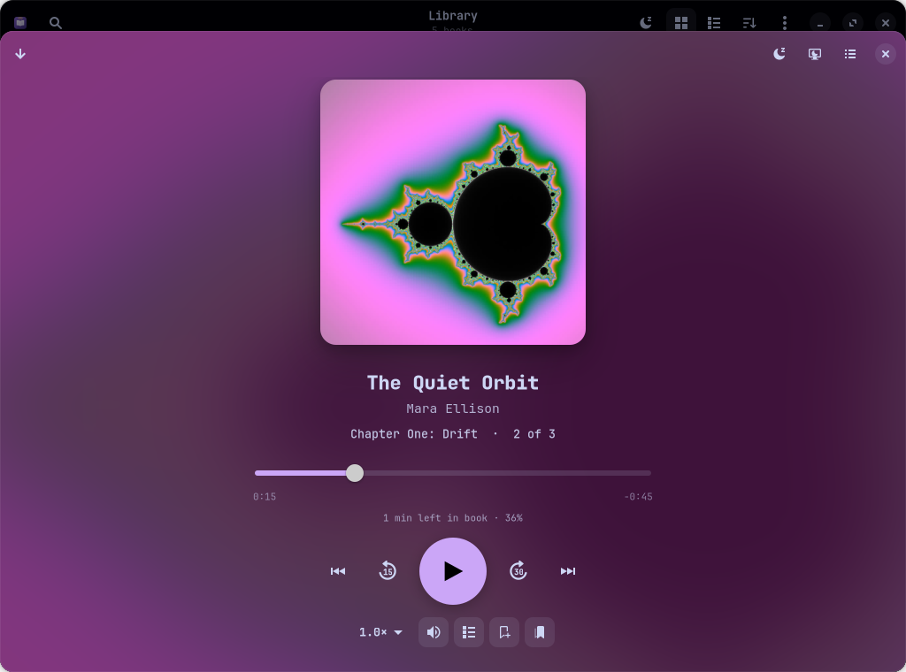
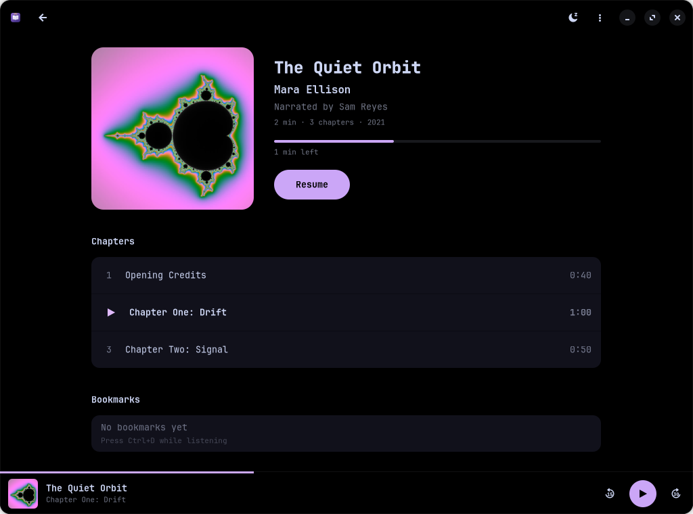
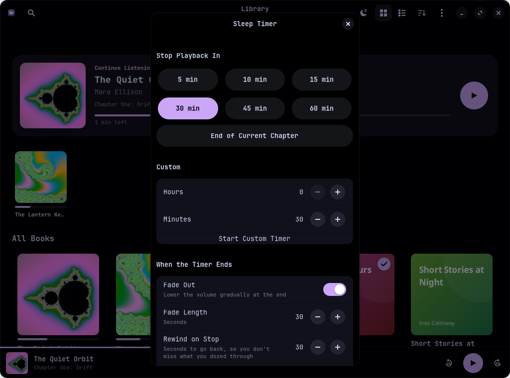

# Lectern

A calm, modern audiobook player for Linux, built with GTK 4, libadwaita and GStreamer. Arch Linux first.

> **This project is vibe coded.** It was written almost entirely by an AI (Claude), directed in plain language by a person who wanted the app to exist. Nobody has reviewed the code line by line. It works for its author, but expect rough edges and read the code before you trust it with anything important.

There's an Android version too: [Lectern for Android](https://github.com/dork40/lectern-android). The two keep your places in sync over your home Wi-Fi: open Preferences here to find the pairing code.



| Now playing | Book details | Sleep timer |
|---|---|---|
|  |  |  |

<!-- Screenshots are rendered from a synthetic sample library by scripts/screenshots.sh -->

## Features

**Playback**
- `.m4b`, `.m4a`, `.mp3`, `.ogg`, `.opus`, `.flac`, and folders of files played as one book (natural sort: `Part 2` before `Part 10`; `CD1/`, `Disc 2/` subfolders are merged)
- Chapters from m4b/m4a (Nero `chpl` and QuickTime chapter tracks), MP3 ID3 `CHAP` frames and Vorbis `CHAPTERxxx` comments; in folders each file is a chapter
- Resumes exactly where you stopped. Position is saved every 3 seconds while playing, on pause, on seek, on quit and on SIGTERM/SIGINT/SIGHUP
- Speed from 0.5× to 3.0× with pitch preserved (`scaletempo`), remembered per book (new books start at the last speed you used)
- **Skip silence**: shortens pauses longer than 0.6 s. Saved progress stays in real book time
- **Bookmarks** with optional notes (<kbd>Ctrl</kbd>+<kbd>D</kbd>), listed on the book page and in the now-playing view
- **Undo jump**: after jumping to a chapter, bookmark or scrubbing far, a toast offers Undo (<kbd>Ctrl</kbd>+<kbd>Z</kbd>)
- **Keep playing when closed**: closing the window while a book plays keeps it playing (media keys/Waybar still work); reopen Lectern to get the window back
- **Listening stats**: today, this week, day streak, total time, books finished, a 14-day chart and your most-listened books
- Skip back and forward (default 15 s / 30 s, configurable), next and previous chapter
- Optional rewind on resume after a long pause (default: 10 s after a break of 10+ minutes)
- Gapless: the files of a folder book play back to back with no pause between them
- MPRIS2: media keys, GNOME/KDE media widgets, Waybar and `playerctl` all work. Next and Previous jump between chapters
- The computer doesn't suspend while a book is playing (systemd-logind sleep inhibitor; screen blanking still works)
- "Open With → Lectern" from a file manager plays that book; files outside your library folders are added too

**Sleep timer**
- Presets (5, 10, 15, 30, 45, 60 min), a custom hours + minutes duration, or "end of current chapter"
- Fades the volume out over the last 30 s (length configurable, can be turned off)
- Live countdown in the header bar with one-click **+5** and cancel
- Rewinds a configurable number of seconds when it stops, so you don't lose what you dozed through
- Only counts down while audio is playing, and remembers your last choice
- Can turn off the screen and keyboard light when it ends or when it starts (both off by default)

**Play on your TV or speakers**
- One "Play On" menu (cast icon in the now-playing view) lists everything Lectern finds on your network:
  - **Chromecast / Google TV / Android TV** (e.g. NVIDIA SHIELD) and Nest speakers
  - **AirPlay TVs and speakers**: Roku TVs (TCL, onn, Hisense…), Samsung/LG/Sony/Vizio TVs with AirPlay, HomePods, AirPlay speakers. Uses [OwnTone](https://owntone.github.io/owntone-server/) (AUR `owntone-server`, offered by `install.sh`), which Lectern runs privately in the background. The first time, the TV shows a 4-digit code that you type into Lectern; after that no code, remote or settings are needed. Lectern keeps doing all the audio processing, so speed, boost, voice clarity, night mode, skip silence, seeking and exact progress all work, and the sleep timer fades the TV's AirPlay volume
  - **Older Rokus that still have Roku's “Play on Roku” receiver** (removed in 2023)
  - **DLNA / UPnP renderers**: most smart TVs (Samsung, LG, Sony…), Sonos, Kodi, many network speakers
- Playback continues from where you are; "This Computer" brings it back to your speakers at the same spot
- Play/pause, seeking, chapters, speed, bookmarks, media keys, the sleep timer and progress saving all keep working. Pausing from the TV remote is followed too
- Roku and DLNA devices get a live MP3 stream that Lectern encodes from the current position, so **speed and audio boost/voice clarity/night mode work on them too**. Chromecast plays the original files (best quality, no effects)
- Roku TVs work out of the box, without touching the TV or its settings. In Roku's default "Limited" network-control mode the TV won't report its playback position, so Lectern keeps the clock itself (from when the TV starts pulling the stream, plus every pause/play it sends) and watches whether the player is still on screen. If the Roku is set to *Control by mobile apps → Permissive*, Lectern reads the exact position from the TV instead, and also notices pausing with the TV remote
- AirPlay needs Avahi running, OwnTone allowed to use the PTP clock ports (`setcap cap_net_bind_service`; without precise clock sync Roku TVs play AirPlay audio too fast and choppy), and the device allowed to reach UDP 6001–6002 and 319–320. `install.sh` sets all of this up (firewall rules limited to your local network). The TV shows the book title, author, chapter and cover
- Lectern serves the audio on TCP port 8765, only for the book being played and behind random URLs. If a firewall blocks the port, Lectern notices and offers the fix; `install.sh` can open it to your local network only

**Screen and keyboard light off**
- One click (or <kbd>Ctrl</kbd>+<kbd>B</kbd>) turns off the screen and the keyboard backlight while the book keeps playing. Touching the keyboard or mouse turns both back on, and the keyboard light returns to its previous level
- Hyprland (with Lua or classic config): mouse and key wake-up are enabled only while the screen is off, then your own settings are restored
- GNOME (Mutter) and KDE Plasma (PowerDevil) are supported too. The keyboard light uses UPower, so it works on most laptops without root

**Cover art**
- Uses a `cover.jpg`/`folder.jpg` (or any image) in the book's folder first, then embedded art
- Otherwise searches iTunes (audiobooks; square covers up to 3000 px), Open Library and Google Books. No API keys needed
- "Find Cover" picker with thumbnail, title, author, source and match score; an "auto-pick best match" setting
- Covers are cached in `~/.cache/lectern/covers`. Embedding into the audio files is off by default and always asks first
- Set a cover from a local image file. Works offline (it falls back to generated covers and shows an "offline" state)

**Audio boost**
- Volume boost from 100% to 300% that actually gets loud: a compressor evens out the narration and a look-ahead limiter (swh-plugins) holds peaks at −1 dBFS, so it never clips. Measured on real LibriVox narration:

  | Slider | Quiet recording | Already-mastered audiobook |
  |---|---|---|
  | 150% | +11.5 dB | +6.0 dB |
  | 200% | +16.1 dB | +8.1 dB |
  | 300% | +18.8 dB | +9.8 dB |

  (+10 dB sounds about twice as loud.) Without swh-plugins a basic soft limiter is used instead (about +9 dB at most).
- **Voice clarity**: 10-band EQ that lifts 2–4 kHz and cuts low rumble
- **Night mode**: a slow compressor plus automatic gain that evens out quiet and loud narration (quiet recordings come up about 10 dB; mastered ones keep their average level)
- Settings apply to all books, or to a single book

**Library**
- Pick one or more folders on first launch (`~/Audiobooks` is offered if it exists)
- Recursive scanning of `Author/Series/Book/` and `Author/Book/` layouts. Metadata comes from tags (title, author, narrator, series, year), with folder and file names as a fallback (`Author - Title`, `Book 3 - Title`, `03 Title`, `Title (Narrated by X)`)
- Folders are watched, so new, moved and deleted books update automatically. A moved book keeps its progress
- Stays fast with big libraries: searching, filtering and sorting reuse the existing widgets (about 10–50 ms with 1,500 books), and cover thumbnails are cached on disk at your display's scale
- Scanning runs in the background with a progress bar. Everything is stored in SQLite, so later launches are instant
- Grid (bookshelf) and list views, a "Continue listening" row, search across title/author/narrator/series, filters (In Progress / Not Started / Finished), grouping by author, series or narrator, and several sort orders
- Edit a book's metadata in the app. Edits are stored in the database and written to the files only if you ask
- Follows the system light/dark theme and accent colour. The layout adapts from phone width to fullscreen; wide windows get bigger covers, a side-by-side Continue Listening row and a larger now-playing cover

### Keyboard shortcuts

| Key | Action |
|---|---|
| <kbd>Space</kbd> | Play / pause |
| <kbd>←</kbd> / <kbd>→</kbd> | Skip back / forward |
| <kbd>Ctrl</kbd>+<kbd>F</kbd> | Search |
| <kbd>Ctrl</kbd>+<kbd>T</kbd> | Sleep timer |
| <kbd>Ctrl</kbd>+<kbd>B</kbd> | Turn off screen and keyboard light |
| <kbd>Ctrl</kbd>+<kbd>D</kbd> | Add bookmark |
| <kbd>Ctrl</kbd>+<kbd>Z</kbd> | Undo the last jump |
| <kbd>Ctrl</kbd>+<kbd>R</kbd> / <kbd>F5</kbd> | Rescan library |
| <kbd>Ctrl</kbd>+<kbd>,</kbd> | Preferences |
| <kbd>Ctrl</kbd>+<kbd>?</kbd> | Keyboard shortcuts |
| <kbd>Esc</kbd> | Close the now-playing view |

Files can also be opened from a file manager with "Open With → Lectern".

## Install (Arch Linux)

```sh
./install.sh          # dependencies + build + tests + install, in one go
./install.sh --run    # same, then start Lectern
./install.sh --remove # uninstall (keeps your library data)
```

`install.sh` wraps `makepkg -si`, which you can also run directly:

```sh
makepkg -si
```

When a firewall (ufw or firewalld) is active, `install.sh` asks whether to open TCP port 8765 to your local network for Chromecast streaming.

`makepkg -si` installs the dependencies below with pacman, builds the package, runs the tests and installs it. Lectern then appears in your app launcher, or you can run `lectern`.

### Dependencies (pacman package names)

Runtime:

```
python python-gobject python-cairo python-mutagen
gtk4 libadwaita gdk-pixbuf2 pango
gstreamer gst-plugins-base gst-plugins-good gst-plugins-bad gst-plugins-ugly gst-libav
swh-plugins python-pychromecast python-zeroconf
```

Build: `python-build python-installer python-setuptools python-wheel`
Tests: `python-pytest`
Optional: `playerctl` (command-line playback control)

The playback chain needs these GStreamer elements: `playbin`, `scaletempo`, `equalizer-10bands`, `level`, `volume`, `audioamplify` and `rglimiter` (from base and good). `gst-plugins-bad`, `gst-plugins-ugly` and `gst-libav` provide codec coverage (AAC/M4B via libav, MP3, Opus and others). `gst-plugins-bad` also contains the LADSPA bridge that loads the `swh-plugins` limiter and compressor.

### Install all dependencies at once

```sh
sudo pacman -S --needed python python-gobject python-cairo python-mutagen gtk4 libadwaita gdk-pixbuf2 pango \
  gstreamer gst-plugins-base gst-plugins-good gst-plugins-bad gst-plugins-ugly gst-libav swh-plugins python-pychromecast \
  python-build python-installer python-setuptools python-wheel python-pytest
```

## Running from source

```sh
python -m lectern            # uses the system Python with the packages above
LECTERN_DEBUG=1 python -m lectern   # verbose logging to the terminal
python -m pytest             # tests: sleep timer, chapter parsing, cover ranking, names, audio gain
```

`scripts/make-sample-library.sh <dir>` generates a small synthetic library (an m4b with chapters and embedded art, a folder book, an mp3 with ID3 chapters, untagged opus/flac) for trying the app out. `scripts/screenshots.sh` renders the README screenshots headlessly.

## Files

| What | Where |
|---|---|
| Library, progress, settings (SQLite) | `~/.local/share/lectern/library.db` |
| Cover cache | `~/.cache/lectern/covers/` |
| Logs | `~/.local/state/lectern/lectern.log` |

## Code layout

```
lectern/
  player.py       GStreamer engine: multi-file timeline, seeking, rate, EOS → next file
  audiofx.py      effects chain (tempo, EQ, compressor, look-ahead limiter, AGC) + GainController
  screen.py       screen/keyboard-light off (Hyprland, GNOME, KDE) + sleep inhibitor
  stats.py        listening statistics helpers
  cast.py         device discovery, LAN media server (byte ranges + live MP3 transcoding), Chromecast
  renderers.py    Roku (ECP) and DLNA/UPnP AVTransport sessions
  airplay.py      AirPlay 2 pairing (SRP-6a/Ed25519/ChaCha20), private OwnTone instance, PCM feed
  metadata.py     tags, chapters, covers, filename parsing (mutagen)
  mp4chapters.py  QuickTime chapter-track reader
  scanner.py      folder discovery, background import, move detection, folder watching
  db.py           SQLite storage
  covers.py       iTunes / Open Library / Google Books search, ranking, download, cache
  sleeptimer.py   pure timer logic + player binding
  mpris.py        MPRIS2 D-Bus service
  app.py          application controller
  ui/             window, library, detail, now playing, dialogs, styles
tests/            pytest suite
```

## License

GPL-3.0-or-later
